<div align="center">



# Snug · 向日葵版

**让手机远程连上电脑时，拥有一块为手机而生的屏幕**

竖屏原生显示 · App 资源库 · 适配所有手机

macOS 14+ / Windows 11 · 向日葵远程控制 · MIT

</div>

## 这是什么

Snug · 向日葵版在被控电脑上创建一块与手机同比例的竖屏（虚拟显示器）：当你用向日葵手机 App 远程连接时，窗口在竖屏里铺满整屏、字号放大，不再把整块横屏桌面等比缩进手机的小屏幕里。

- **macOS 版**：菜单栏应用。手机连入后虚拟屏自动升起，单指滑动变成滚动、长按出右键菜单（向日葵下手势翻译暂不可用，见应用内说明）。
- **Windows 版**（v2.6.0 起）：主控连入自动建屏并打开 App 资源库，断开自动移除；资源库里点哪个 App，窗口就全屏到手机屏，多窗口可逐个选、逐个关。

## 关于本项目

本项目由向日葵（贝锐 Oray）的一名技术人员以**个人身份**维护：看到原 Snug 项目后，使用 **Muse（免费版）**将其移植到向日葵远程控制并重新打磨。本项目为个人作品，**非向日葵官方产品**。原项目作者与许可证见文末「致谢与许可证」。

## 实测状态

**macOS 版已在真实 Mac 上测试可用。** Mac mini（M4）/ macOS 26 / 向日葵 16.8.1 环境下实测：手机连入后虚拟屏自动升起、窗口铺满、点击正常。正式发布包经 Apple Developer ID 签名与公证，可直接安装使用。

**Windows 版已在真实 Windows 11 机器上实测**虚拟屏创建/移除与 App 资源库可用；手机串流的系统性体验测试还在进行中（清单见 `windows/SPIKE.md`）。

## 下载与安装

两个平台的包都在同一个 [Releases](https://github.com/skyvense/snug-sunlogin/releases) 页面，版本号一致。

**macOS**

1. 下载最新版 `Snug-Sunlogin-<版本>.dmg`
2. 打开 DMG，把 Snug 拖进「应用程序」
3. 首次打开时按欢迎页授予「辅助功能」权限，之后常驻菜单栏
4. 手机用向日葵连入这台 Mac，在向日葵的屏幕列表里选择「Snug 手机屏」即可

**Windows**

1. 下载最新版 `Snug-Sunlogin-Windows-<版本>.zip` 并解压
2. 首次使用先（以管理员身份）运行包内的 `setup-virtual-display.ps1`，装好虚拟显示驱动
3. 运行 `SnugWindows.exe`（管理员），在主窗口选好手机型号；默认是「自动」模式
4. 手机用向日葵连入这台电脑：自动建屏并打开 App 资源库，在资源库里点 App 即可全屏使用；断开后屏自动移除

## 系统要求

- 被控端（macOS）：macOS 14+，已安装向日葵 Mac 版（AweSun）
- 被控端（Windows）：Windows 11，已安装向日葵 Windows 版
- 控制端：手机向日葵 App（iPhone / Android 均可）

## 工作原理

当前版本的 Snug 不调用向日葵的任何接口，只观察被控机本机的信号来判断「有手机连进来了」：macOS 版看向日葵的悬浮窗、系统推流日志与控制端列表；Windows 版看向日葵桌面代理进程（命令行带 `--mod=desktopagent`）。因此它与向日葵客户端的具体版本解耦，客户端升级一般不影响使用。虚拟屏在 macOS 上由系统虚拟显示接口创建，在 Windows 上由开源 Virtual Display Driver 提供；Windows 版还会把虚拟屏的显示缩放自动调到 250%，手机上界面更大更好点。细节见 [docs/how-it-works.md](docs/how-it-works.md)（macOS）与 [windows/README.md](windows/README.md)（Windows），移植的逐项适配记录见 [PORTING.md](PORTING.md)。

## 路线图

- **对接向日葵开放 API**：后续版本考虑直接对接向日葵官方开放 API。届时连接建立后即可自动准备好手机屏，不再需要用户在屏幕列表里手动选择手机屏。
- **控制端识别适配**：进一步适配向日葵的控制端列表结构（当前对未知控制端按手机处理）。

## 从源码构建

macOS 版：

```
git clone https://github.com/skyvense/snug-sunlogin && cd snug-sunlogin
scripts/snug check     # 构建并运行全部测试
scripts/snug install   # 构建、安装并打开
scripts/snug dist      # 打签名 + 公证的 DMG（需要 Developer ID 证书与公证档案）
```

Windows 版在 `windows/` 目录（Rust + Win32）：`cargo build --release`，细节见 [windows/README.md](windows/README.md)。

发版走 GitHub Actions：推送 `v*` 标签、在仓库的 `release` 环境审批后，自动产出签名公证的 DMG 与 Windows zip 并挂到对应 Release（两边共用根目录 `VERSION` 的同一个版本号）。

## 与原版的关系

- 本项目与原版 Snug 可同机共存：App bundle id、数据目录、日志文件均已隔离，更新源独立，不会被原版更新包覆盖
- 原版仓库：[zephyr4123/snug](https://github.com/zephyr4123/snug)（UU远程版）

## 致谢与许可证

MIT © 2026 AoyamaShou，© 2026 zephyr4123（见 [LICENSE](LICENSE)）。

本项目基于 [zephyr4123](https://github.com/zephyr4123) 的 [Snug](https://github.com/zephyr4123/snug) 移植，其前身为 AoyamaShou 的 [UUyc-companion](https://github.com/aoyamashou/UUyc-companion)。原作者版权声明保留于 LICENSE，逐项改动见 PORTING.md。
